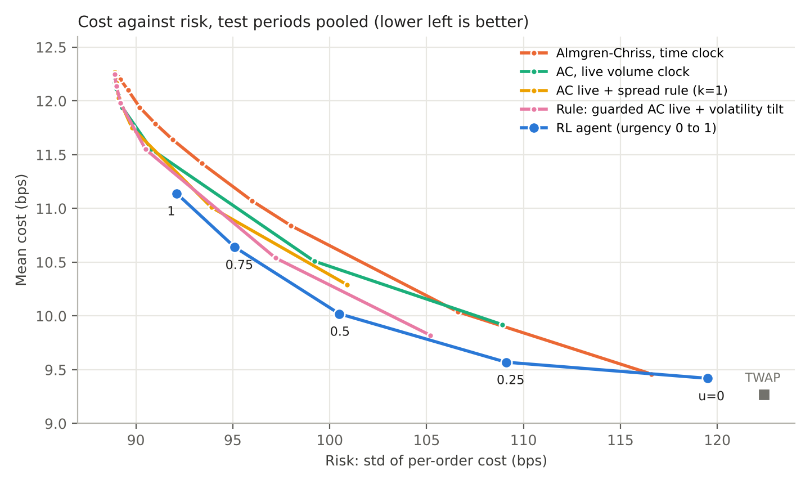
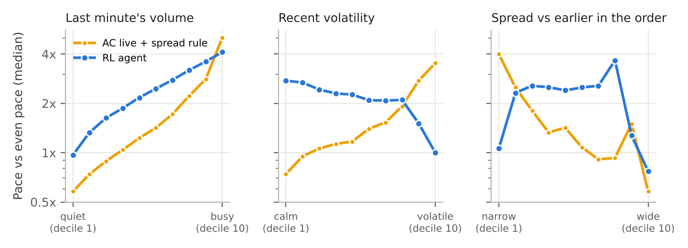

# RL Optimal Execution

A reinforcement learning agent for institutional order execution: split a
large order across the trading day to trade off market-impact cost against
price risk. The agent is trained in a limit-order-book simulator built on two
years of US large-cap data, and compared with tuned classical strategies.

> **Correction.** Early versions of this project (and a LinkedIn post)
> reported ~27% savings vs TWAP and ~30% vs Almgren-Chriss. Those figures came
> from a flawed cost metric and a flawed impact model. See
> `PROJECT_AUDIT.md` §9–11.

## Result

The data covers 13 tickers and 488 trading days, with orders of 5% of ADV.
There are 4 walk-forward periods × 3 independently trained policies, and each
is tested only on its own unseen period.

- **The simulator is honest about the test periods.** It is recalibrated for
  every period on its training days only, and charges each minute's **real**
  quoted spread.
- **Cost** is signed implementation shortfall (bps).
- **The comparison is at equal risk.** The agent has an urgency dial that
  trades cost for risk, so it is compared with each classical strategy at the
  same risk.
- **No model is chosen on test data.** Each agent's checkpoint is picked on
  the end of its training window.

| Urgency | vs best classical | vs Almgren-Chriss (time clock) | vs AC on live volume |
|---|---|---|---|
| 0 | −0.06 (tie) | −0.06 | −0.50 |
| 0.25 | **−0.17** | −0.33 | −0.42 |
| 0.5 | **−0.16** | −0.55 | −0.43 |
| 0.75 | −0.14 (n.s.) | −0.51 | −0.37 |
| 1 | −0.11 (n.s.) | −0.42 | −0.25 |

bps; negative = agent cheaper; bold = 95% interval (day-clustered bootstrap)
excludes zero. "Best classical" is the cheapest, at that risk, of 15 strategy
families, each swept over its parameter:

- Almgren-Chriss on time, expected-volume and live-volume clocks;
- POV;
- spread-aware AC;
- the same schedules inside the agent's guardrail;
- a rule distilled from the agent's own behaviour.

**The agent beats every classical strategy tested by about 0.16 bps at
urgency 0.25–0.5** (about 1.5% of cost). Elsewhere it is not significantly
different. It uses only information a real trader has. The result:

- holds across tight guardrail settings;
- does not come from the guardrail itself;
- carries over to stocks the agent never trained on, at a small cost
  (≈0.1 bps);
- is only about a third explained by a simple rule built from the agent's
  own behaviour.

## What the agent learned

It does not win by catching narrow spreads. It pays slightly *more* than the
day's average spread, because it trades heavily at the open. It wins on
**market impact**:

- it trades more in busy minutes;
- it slows down when recent volatility is high, while the spread-aware
  benchmark speeds up;
- it pauses only for very wide spreads.

## What this project is really about

Most of the work was finding out why results looked better (or different)
than they should. Each problem was found, measured and fixed:

| Problem | Effect |
|---|---|
| Cost metric ignored favourable price moves | ~27% edge → a few bps |
| Permanent impact charged per fill, not per order | a few bps → slightly worse than AC |
| Almgren-Chriss benchmark was mathematically TWAP | overstated AC comparison |
| Clipped action space; agent idle 28% of minutes | +0.8 → +0.14 bps from the optimum |
| Resting orders modelled too generously | spurious −2.5 bps |
| Agent could see hidden simulator state | most of a −0.3 bps edge |
| Best checkpoint chosen on test data | model-selection leakage |
| Simulator calibrated on the test periods too | spread level overstated 10–24%; ADV computed on test days |
| Synthetic spread too persistent | made the spread-aware benchmark look strong (v9 "tie") |
| Spread input against a fixed level | agent mistook drift for wide spreads, then paid to catch up |
| Best checkpoint still chosen on the test period (a "fixed" leak that wasn't) | edge 0.22–0.29 → 0.16–0.17 bps |

A fix that failed is reported too. Training *with* the guardrail made the
agent rely on it, and the edge disappeared.

Details, with every number: `PROJECT_AUDIT.md`.

## Training infrastructure

Profiling showed where training time goes: simulating the market (CPU), not
the neural network. A GPU made training 43% *slower*, and a single-process
checkpoint evaluation took 28% of the time. Running 3 trainings at once,
each in its own folder, with less frequent evaluation, cut training of the
12 walk-forward models from about 20 h to 10 h on a 6-core desktop
(`evaluation/bench_train.py`, `evaluation/parallel_train.py`).

## Limitations

- **The policy alone is not usable at low urgency.** On low-volume,
  wide-spread days after a regime shift it falls behind and pays to catch
  up. The schedule guardrail is part of the method: it was fixed in advance,
  and any tight setting (2.5–5%) gives the result.
- **The edge is small and uneven across test periods.**
- **Impact magnitudes and the volatility exponent of impact are assumed.**
  They cannot be measured from public data.
- **No resting (limit) orders.**
- **The simulator is synthetic and has never been run against replayed order
  flow.**
- **The four test periods have been reused during development.** A clean
  confirmation needs newer data.

## Architecture

- `simulator/`: limit order book, Hawkes order flow, real minute spreads and
  realised volatility, temporary impact vs live minute volume, cumulative
  square-root permanent impact
- `agent/`: Gymnasium environment, PPO (Stable-Baselines3), mean-variance
  reward, squashed participation-rate action, schedule guardrail
- `evaluation/`: per-fold calibration, paired evaluation, benchmark sweeps,
  equal-risk frontier comparison, day-clustered bootstrap, walk-forward,
  unseen-ticker test, behaviour probe

## Running it

See `PROJECT_AUDIT.md` §6. Market data is licensed (Databento) and not
included; `evaluation/fetch_tick_data.py` pulls it given an API key.
